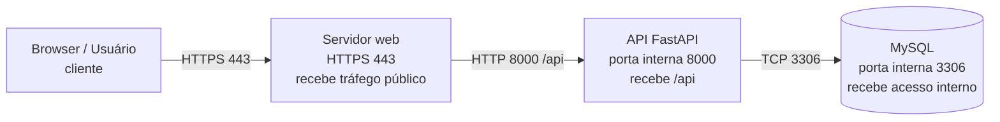

# Infraestrutura

## 1. Arquitetura de produção

Observação para o Mermaid Live: cole somente o conteúdo a partir de `flowchart LR`, sem o bloco Markdown.

- Navegador: roda na máquina do usuário; é cliente; não precisa de porta de servidor pública.
- Servidor web: roda em uma máquina de aplicação; atende em HTTPS na 443; recebe tráfego público e encaminha `/api` para a API interna na 8000.
- API: roda em máquina interna do backend; atende na 8000; recebe tráfego do servidor web e não expõe acesso público direto.
- MySQL: roda em máquina interna de dados; atende na 3306; recebe somente conexões da API; não recebe tráfego público.

## 2. Desenvolvimento e produção

| Camada | Desenvolvimento (hoje no projeto) | Produção (proposta) |
|---|---|---|
| API | FastAPI local, executada com `fastapi dev main.py` na porta 8000; o backend usa SQLAlchemy e pode apontar para SQLite local ou MySQL local; veja [backend/main.py](C:/Users/fabio/Desktop/Avaliacao%20Front%20-%20Back/backend/main.py) e [backend/configuracao.py](C:/Users/fabio/Desktop/Avaliacao%20Front%20-%20Back/backend/configuracao.py). | API em máquina interna, sem exposição direta ao público, ouvindo na 8000 e acessível somente pelo servidor web. |
| Tela | React/Vite em ambiente local na porta 5173; a UI usa a API em host local e porta 8000 em [frontend/src/App.jsx](C:/Users/fabio/Desktop/Avaliacao%20Front%20-%20Back/frontend/src/App.jsx). | Tela servida em HTTPS na 443 e entregue ao navegador como origem pública; a mesma origem pode receber `/api` encaminhado para a API interna. |
| Banco | SQLite local ou MySQL local conforme [backend/.env.exemplo](C:/Users/fabio/Desktop/Avaliacao%20Front%20-%20Back/backend/.env.exemplo); o exemplo usa `BANCO_HOST=localhost`. | MySQL interno, em rede privada, na 3306, acessível apenas pela API; sem acesso direto do navegador ou da internet. |
| `.env` | Arquivo local de ambiente com banco, JWT e CORS; exemplo em [backend/.env.exemplo](C:/Users/fabio/Desktop/Avaliacao%20Front%20-%20Back/backend/.env.exemplo). | Variáveis injetadas no ambiente de execução, fora do repositório; sem uso de `.env` versionado; `JWT_COOKIE_SECURE=true` e `FRONTEND_URL` ajustados ao ambiente real. |
| CORS | O backend habilita CORS em [backend/main.py](C:/Users/fabio/Desktop/Avaliacao%20Front%20-%20Back/backend/main.py) e usa `FRONTEND_URL` em [backend/configuracao.py](C:/Users/fabio/Desktop/Avaliacao%20Front%20-%20Back/backend/configuracao.py), com padrão de `http://localhost:5173`. | ? Se a tela e a API ficarem na mesma origem pública, não há necessidade de CORS entre elas; a proposta mantém a mesma origem e usa o servidor web para encaminhar `/api`. |

## 3. O caminho do login

1. O usuário clica em “Entrar” na tela do frontend.
   - Roda na máquina do usuário.
2. O navegador envia a requisição ao servidor web via HTTPS na 443.
   - Roda no servidor web.
3. O servidor web encaminha a chamada para a API interna em `/api/autenticacao/login`, na porta 8000.
   - Roda no servidor web, com destino na máquina da API.
4. A API valida o usuário e a senha.
   - Roda na máquina da API.
5. A API consulta o banco para confirmar a identidade e os dados da conta.
   - Roda na máquina da API, acessando o MySQL interno na 3306.
6. Se a autenticação for bem-sucedida, a API gera um JWT e define o cookie `HttpOnly` na resposta.
   - Roda na máquina da API.
7. O navegador recebe a resposta e guarda o cookie do login.
   - Roda na máquina do usuário.
8. Nas próximas telas, o navegador manda esse cookie automaticamente junto com as requisições.
   - Roda na máquina do usuário para disparar a chamada; a validação continua na API.
9. Ao abrir ou recarregar a aplicação, o frontend chama `/usuarios/me` para restaurar a sessão.
   - Roda na máquina do usuário; a verificação final acontece na API e no banco.

Observação: o código atual já usa cookie `HttpOnly` no backend em [backend/rotas/autenticacao.py](C:/Users/fabio/Desktop/Avaliacao%20Front%20-%20Back/backend/rotas/autenticacao.py) e `credentials: "include"` no frontend em [frontend/src/App.jsx](C:/Users/fabio/Desktop/Avaliacao%20Front%20-%20Back/frontend/src/App.jsx), o que combina com a arquitetura proposta.

## 4. O que está chumbado

Os pontos abaixo mostram onde o código ainda usa `localhost` ou `127.0.0.1`. Isso não é, por si só, “erro”, mas sinaliza que o projeto ainda está orientado ao ambiente de desenvolvimento.

- [backend/configuracao.py](C:/Users/fabio/Desktop/Avaliacao%20Front%20-%20Back/backend/configuracao.py): linha 35
  - Valor: `http://localhost:5173`
  - Uso: servidor; padrão de origem permitida para CORS em desenvolvimento.
  - Observação: é um valor de desenvolvimento; em produção, a origem pública real ou a mesma origem da tela deve substituir esse valor.

- [backend/.env.exemplo](C:/Users/fabio/Desktop/Avaliacao%20Front%20-%20Back/backend/.env.exemplo): linha 5
  - Valor: `BANCO_HOST=localhost`
  - Uso: servidor; aponta o banco para a máquina local em desenvolvimento.
  - Observação: em produção, o MySQL teria um host interno específico, não `localhost`.

- [backend/.env.exemplo](C:/Users/fabio/Desktop/Avaliacao%20Front%20-%20Back/backend/.env.exemplo): linha 8
  - Valor: `FRONTEND_URL=http://localhost:5173`
  - Uso: servidor; origem autorizada para CORS em desenvolvimento.
  - Observação: é configuração local de dev; não representa a produção.

- [frontend/src/App.jsx](C:/Users/fabio/Desktop/Avaliacao%20Front%20-%20Back/frontend/src/App.jsx): linha 12
  - Valor: `${window.location.protocol}//${window.location.hostname}:8000`
  - Uso: navegador; monta a URL da API usando o host atual quando a variável de ambiente não está definida.
  - Observação: isso funciona no desenvolvimento local, mas não deve ser tratado como endpoint de produção.

- [README.md](C:/Users/fabio/Desktop/Avaliacao%20Front%20-%20Back/README.md): linha 73
  - Valor: `http://127.0.0.1:8000/docs`
  - Uso: documentação do ambiente local de desenvolvimento.
  - Observação: é referência de execução local, não de produção.

- [PASSO_A_PASSO_PROJETO.md](C:/Users/fabio/Desktop/Avaliacao%20Front%20-%20Back/PASSO_A_PASSO_PROJETO.md): linha 325
  - Valor: `http://127.0.0.1:8000/docs`
  - Uso: documentação local de desenvolvimento.
  - Observação: aponta o ambiente do dev, não a arquitetura final.

- [PASSO_A_PASSO_PROJETO.md](C:/Users/fabio/Desktop/Avaliacao%20Front%20-%20Back/PASSO_A_PASSO_PROJETO.md): linha 424
  - Valor: `http://localhost:5173`
  - Uso: navegador; endereço do Vite em desenvolvimento.
  - Observação: é uma origem local de dev; não deve ser usada como URL pública de produção.

## Perguntas para apresentação

1. No desenho final, a tela e a API ficam na mesma origem pública ou você prefere deixar a API em subcaminho e a tela em um domínio separado? Como isso altera o CORS?
2. O projeto atual ainda está preparado para desenvolvimento local, mas a produção exige segurança de sessão e cookies. Qual ponto você considera mais crítico para reforçar: HTTPS, cookie `Secure` ou a política de origem?
3. Você acredita que a arquitetura proposta é suficiente para “sair da máquina” como entrega de aula, ou ainda faltam decisões de operação real, como quem domina o ambiente, acesso ao banco e quem expõe a porta 443?
