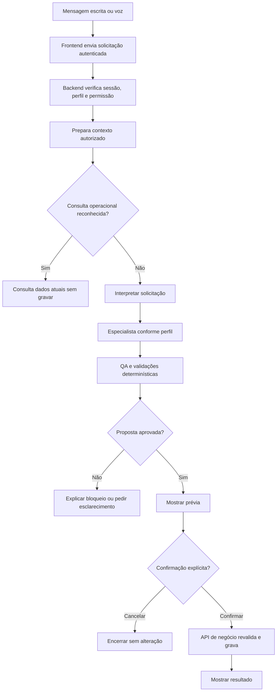

# Flora — fluxo, possibilidades e testes

Este documento consolida a referência da Flora existente no Cesta do Vale para apoiar a criação ou adaptação de outro sistema. Ele descreve o comportamento documentado no projeto de origem; permissões, dados, regras e integrações devem ser redefinidos para o novo domínio.

## 1. Papel da Flora

Flora é a assistente virtual do Cesta do Vale. Ela recebe pedidos em linguagem natural, consulta informações permitidas ao perfil autenticado e pode preparar propostas para revisão. A assistente não substitui autenticação, autorização nem validação do backend. Ações que alteram dados exigem confirmação explícita e passam pelas rotas de negócio existentes, que validam novamente os dados antes de gravar.

## 2. O que a Flora pode fazer

### Consultas sem alteração de dados

- Mostrar o catálogo e consultar disponibilidade/preços.
- Recomendar ou preparar uma cesta para revisão.
- Consultar estoque, pendências, entregas e situação/detalhes de pedidos, conforme o perfil.
- Responder com dados atuais do banco em consultas operacionais reconhecidas localmente.
- Exibir resposta em texto e, se habilitado, reproduzi-la por voz.

Consultas não alteram estoque nem pedidos. No projeto de origem, produtor pode consultar estoque compartilhado e pedidos permitidos; assinante consulta apenas pedidos vinculados à própria conta e não recebe consultas de estoque.

### Ações com proposta e confirmação

- **Assinante:** preparar um pedido de cesta, validar a composição, mostrar prévia e aguardar confirmação antes de criar o pedido.
- **Produtor:** preparar uma declaração de separação completa para conferência; só após confirmação a API tenta concluir a separação.
- Quando o produtor precisa ajustar quantidades de itens individualmente, a Flora direciona ao fechamento manual com os controles de quantidade.

No projeto de origem, envio de cesta, encerramento com faltantes e desfazer separações permanecem no fluxo manual, sem execução pela Flora.

## 3. Fluxo ponta a ponta

1. A pessoa abre a Flora e envia uma mensagem escrita ou dita.
2. O frontend envia a solicitação autenticada para `POST /assistente/analisar`.
3. O backend identifica conta e perfil pela sessão e verifica a permissão `assistente.usar`.
4. O serviço determina o modo da assistente e prepara contexto permitido: catálogo e dados associados à conta/perfil.
5. Consultas operacionais reconhecidas podem ser respondidas localmente com dados do banco, sem depender do modelo.
6. Para outras mensagens, o modo OpenRouter executa intérprete, especialista do perfil e QA em sequência. O modo simulado usa regras locais.
7. A validação determinística do backend pode bloquear propostas que o modelo aprovou, por exemplo por falta de estoque, limite inválido, produto inexistente ou ação proibida.
8. Se houver proposta aprovada, o frontend apresenta uma prévia clara, com os dados relevantes e ação explícita de confirmar ou cancelar.
9. Ao confirmar, o frontend chama o fluxo/rota de negócio existente. O backend revalida estado atual, permissões, estoque e composição antes de persistir.
10. A interface informa o resultado; a pessoa pode consultar o pedido no fluxo normal do sistema.

## 4. Componentes de referência

- `backend/rotas/assistente.py`: autenticação, permissão e contrato HTTP.
- `backend/ia/servico.py`, `fluxo.py`, `contexto.py`: caso de uso, orquestração e contexto.
- `backend/ia/agentes/`: intérprete, especialista de assinante/produtor e QA.
- `backend/ia/validacao.py`: regras determinísticas da proposta.
- `backend/ia/consultas.py`: consultas operacionais locais.
- `backend/ia/provedores/`: interface, OpenRouter e modo simulado.
- `backend/ia/prompts/`: instruções por papel.
- `frontend/src/funcionalidades/assistente/Assistente.jsx`: conversa, prévia e confirmação.
- `frontend/src/funcionalidades/assistente/api.js`: integração com API.

Os caminhos são da aplicação de origem; não os copie sem confirmar a estrutura do novo repositório.

## 5. Conversa, voz e limites

- A interface pode oferecer microfone para fala em texto, com revisão antes do envio, e síntese de voz para a resposta.
- A voz não confirma operações. A confirmação continua sendo uma ação explícita na tela.
- A síntese pode usar voz do navegador ou um provedor externo configurado; disponibilidade e qualidade dependem do ambiente.
- A arquitetura documenta memória de conversa persistida como evolução separada. Não confundir histórico de pedidos com memória conversacional.
- O fluxo de agentes atual descrito na arquitetura chama QA antes da validação local. O fluxograma evolutivo que coloca validação antes do QA não representa o comportamento atual.
- Cada solicitação no modo OpenRouter pode gerar três chamadas sequenciais; registrar custo, timeout, limites e comportamento de indisponibilidade ao planejar outro sistema.

## 6. Regras que devem ser preservadas

1. Identidade e perfil vêm do backend, nunca de texto enviado pelo modelo ou pelo navegador.
2. O contexto deve conter somente dados que aquela conta e perfil podem acessar.
3. Respostas de consulta devem vir de dados confiáveis do sistema, não de números inventados pelo modelo.
4. Modelo/QA não substituem validações determinísticas de negócio.
5. A análise da Flora não grava operação por si só.
6. Toda mutação exige confirmação e revalidação do backend no momento da execução.
7. Bloqueios, falhas do provedor e propostas incompletas não podem liberar execução.
8. A mesma ação repetida ou concorrente não deve duplicar pedido, estoque ou notificação.
9. Deve existir caminho manual equivalente para ações não suportadas ou quando a assistente falhar.

## 7. Roteiro de testes

### Unidade e contratos

- Interpretar intenção, perfil e estrutura de saída.
- Validar esquemas de entrada e saída e respostas malformadas do modelo.
- Cobrir regras de domínio: tamanho/limites, quantidades, produto inválido, estoque insuficiente e ações proibidas.
- Verificar que QA aprovado não supera uma reprovação determinística.
- Testar prompts carregados, seleção de modelos, timeouts e exceções sem expor dados internos.

### API e integração

- Sem sessão, token inválido/expirado ou sem permissão: negar acesso.
- Assinante não acessa pedidos de outra conta; produtor e assinante recebem apenas consultas autorizadas.
- Consultas de catálogo/estoque/pedidos retornam dados atuais e não modificam banco.
- OpenRouter: testar sequência de papéis, contexto autorizado, JSON inválido, falha/timeout e bloqueio seguro, usando transporte simulado.
- Modo simulado: funciona sem chamada externa e obedece às mesmas regras de acesso e validação.
- Pedido: análise não grava; confirmação cria apenas uma vez; cancelar prévia não cria pedido.
- Separação: incompleta, excessiva, duplicada ou desatualizada é bloqueada; completa só altera após confirmação e revalidação.
- Concorrência e repetição: confirmar, cancelar ou concluir simultaneamente não duplica efeitos.
- Voz: configuração sem chave, resposta válida, falha do provedor, tamanho/tipo de áudio e limites de uso.

### End-to-end no navegador

- Abrir Flora em cada perfil, enviar uma pergunta e conferir resposta.
- Consultar catálogo, obter proposta de cesta, revisar, cancelar e confirmar; conferir histórico e estado persistido.
- Fazer consulta sem mutação e comprovar que pedido/estoque não mudou.
- Como produtor, preparar separação, verificar resumo/quantidades, confirmar e conferir estado no fluxo operacional.
- Verificar estados de carregamento, erro, indisponibilidade, bloqueio, proposta e sucesso.
- Testar teclado, rótulos acessíveis, leitura da prévia, foco dos diálogos, responsividade e ausência de overflow.
- Testar microfone permitido/negado/indisponível, revisão da transcrição, reprodução/interrupção e encerramento ao fechar a tela.
- Testar em navegadores e dispositivos que o projeto pretende suportar.

### Aceitação e operação

- Pessoa usuária consegue concluir as tarefas suportadas sem instrução externa.
- A proposta é compreensível e mostra o que será alterado antes da confirmação.
- O caminho manual funciona quando a Flora não entende ou não pode executar a ação.
- Configuração real de provedor é validada em ambiente controlado, sem usar dados de produção sem autorização.
- Registrar versão, ambiente, dados de teste, resultados, limitações e evidências; não tratar testes simulados como validação real do provedor.

## 8. Evidências existentes no Cesta do Vale

Referências na pasta `02_REFERENCIAS/`:

- `docs/ia/arquitetura.md`: comportamento atual, limites e evolução proposta.
- `docs/ia/fluxo-assistente.mmd`: diagrama evolutivo.
- `docs/ia/cenarios.md`: cenários de validação da IA.
- `docs/ia/RELATORIO_TESTES_2026-11-07.md`: resultados históricos e limitações.
- `docs/ia/TESTE_UX_FLORA.md`: roteiro manual de UX.
- `docs/FLUXOS.md`: jornadas gerais de assinante/produtor.
- `backend/CASOS_DE_TESTE.md`: casos de autenticação e permissões.
- `docs/ANALISE_SISTEMA.md`: lacunas técnicas e validações pendentes.
- `frontend/tests/e2e/flora.spec.js`: E2E de interface da Flora.
- `backend/tests/ia/` e `backend/tests/test_assistente_pedido.py`: testes da API e regras da assistente.

Os resultados nesses arquivos são evidência histórica do projeto de origem, não garantia de que os testes estejam passando no novo projeto. A análise de sistema também registra validação completa no navegador e provedores externos como pendências operacionais.

## 9. Como adaptar para um novo sistema

Antes de implementar, decidir e registrar:

- Qual problema a assistente resolve e quais perfis existem.
- Fontes de dados e campos que cada perfil pode consultar.
- Intenções suportadas, intenções proibidas e mutações permitidas.
- Quais mutações exigem confirmação e como desfazer/cancelar.
- Regras determinísticas, limites e comportamento diante de dados desatualizados.
- Provedor, modelos, custos, limites, retenção de dados e alternativa sem IA.
- Se conversa terá memória; por quanto tempo e como isolar por conta.
- Necessidade de voz, navegadores suportados e alternativa acessível.
- Critérios de aceite, cenários E2E e responsáveis pela validação.

Não herdar automaticamente nomes, personas, tamanhos de cesta, permissões, estados, provedores ou regras do Cesta do Vale.
