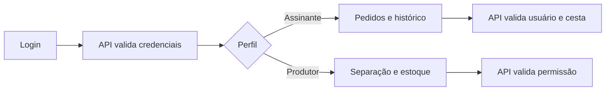

# Fluxos do sistema — Cesta do Vale

## 1. Fluxo de acesso

1. A pessoa abre a tela de login.
2. Informa usuário e senha.
3. O backend autentica e identifica o perfil.
4. A assinante é direcionada ao pedido/histórico; o produtor é direcionado à separação.
5. Rotas protegidas validam a sessão e as permissões antes de responder.

## 2. Fluxo da assinante — criar pedido

1. Aline acessa **Pedir a cesta**.
2. Escolhe o tamanho da cesta.
3. Escolhe uma cesta pronta ou seleciona os produtos.
4. O sistema valida limite, estoque e quantidades.
5. Aline revisa a composição.
6. Confirma o pedido.
7. A cesta é criada como pendente e aparece no histórico.

## 3. Fluxo da assinante — acompanhar pedido

1. Aline abre o histórico.
2. Seleciona uma cesta.
3. Consulta produtos, quantidades e situação.
4. Se estiver pendente, pode cancelar.
5. Após a separação, pode confirmar o recebimento.

## 4. Fluxo do produtor — separar pedido

1. Vanderlei abre a área de separação.
2. Consulta as cestas pendentes.
3. Abre uma cesta.
4. Registra os produtos separados, individualmente ou em lote.
5. Pode desfazer a última ação quando necessário.
6. Ao concluir todos os itens, finaliza a separação.
7. O status da cesta é atualizado para a próxima etapa do fluxo.

## 5. Fluxo de autorização

## 6. Referências

- [`DIAGRAMA_GRUPOS.html`](DIAGRAMA_GRUPOS.html)
- [`../PASSO_A_PASSO_PROJETO.md`](../PASSO_A_PASSO_PROJETO.md)
- Telas em `frontend/src/componentes/`.
