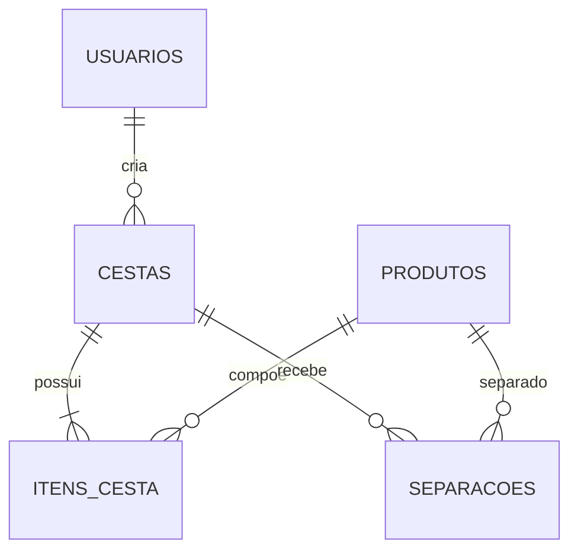

# Banco de dados — Cesta do Vale

## 1. Configuração

A conexão é centralizada em [`../backend/banco.py`](../backend/banco.py) e configurada por variáveis de ambiente. O projeto suporta SQLite para desenvolvimento e PostgreSQL/Supabase conforme o ambiente.

## 2. Entidades

| Tabela | Finalidade |
|---|---|
| `usuarios` | Contas, credenciais e perfil de acesso. |
| `produtos` | Catálogo e estoque disponível. |
| `cestas` | Pedido principal da assinante e seu status. |
| `itens_cesta` | Produtos e quantidades escolhidos em uma cesta. |
| `separacoes` | Quantidades já separadas pelo produtor. |

## 3. Relacionamentos

## 4. Regras de integridade

- `cestas.usuario_id` referencia `usuarios.id`.
- `itens_cesta.cesta_id` referencia `cestas.id` com exclusão em cascata.
- `itens_cesta.produto_id` referencia `produtos.id`.
- `separacoes.cesta_id` referencia `cestas.id` com exclusão em cascata.
- Uma cesta não pode repetir o mesmo produto em `itens_cesta`.
- Uma cesta não pode repetir o mesmo produto em `separacoes`.

## 5. Migrações

As alterações do schema estão versionadas em [`../backend/migracoes/versions/`](../backend/migracoes/versions/). Os modelos SQLAlchemy ficam em [`../backend/modelos/`](../backend/modelos/).

## 6. Diagrama complementar

O diagrama visual de grupos, rotas, permissões e banco está em [`DIAGRAMA_GRUPOS.html`](DIAGRAMA_GRUPOS.html).
