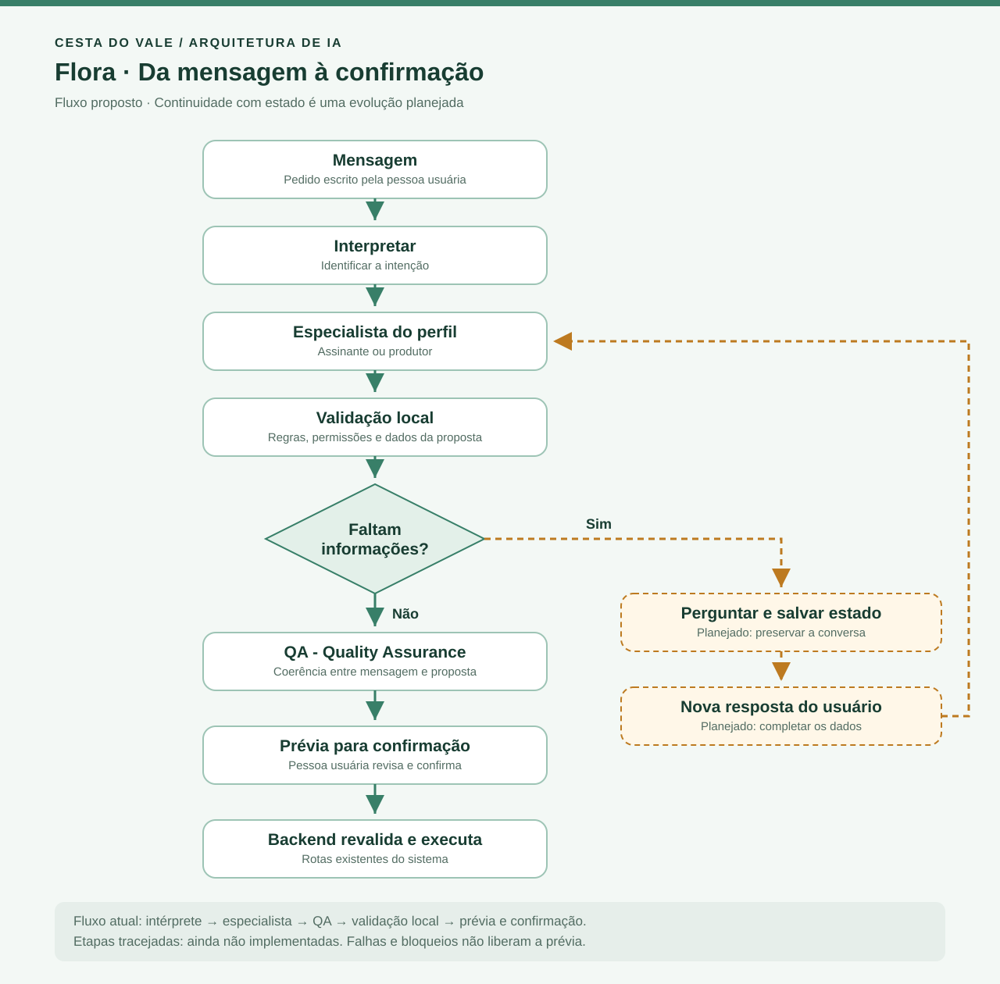
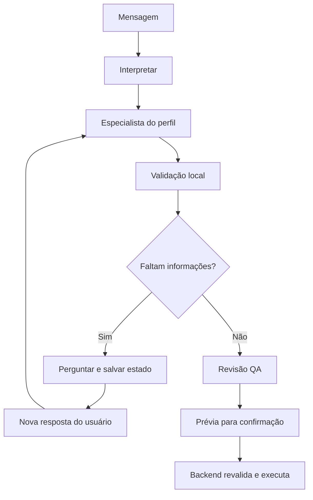

# Flora do Vale — arquitetura da assistente de IA

Nome público: **Flora do Vale**. O botão de acesso é **Falar com a Flora**.
A apresentação é: “Olá! Sou a Flora, a assistente virtual do Cesta do Vale.
Como posso ajudar?”. Os nomes técnicos de arquivos e endpoints permanecem `assistente`.

Implementação reorganizada em 07/11/2026. A IA é um módulo do backend FastAPI,
com integração OpenRouter e demonstração simulada. Não exige um serviço separado.

## Onde encontrar cada parte

```text
backend/
├── rotas/assistente.py        # Autenticação, permissão e resposta HTTP
├── esquemas/assistente.py     # Entrada e saída públicas da API
├── ia/
│   ├── servico.py             # Caso de uso: analisar mensagem
│   ├── contexto.py            # Catálogo e histórico autorizado, até 20 cestas
│   ├── fluxo.py               # Sequência dos agentes e resultado final
│   ├── contratos.py           # Respostas internas tipadas com Pydantic
│   ├── validacao.py           # Regras locais da proposta
│   ├── agentes/
│   │   ├── interprete.py
│   │   ├── assinante.py
│   │   ├── produtor.py
│   │   └── qa.py
│   ├── prompts/              # Instruções base e específicas em Markdown
│   └── provedores/
│       ├── contrato.py        # Interface de chamada e exceção segura
│       ├── openrouter.py      # HTTP, modelo, schema e falhas externas
│       └── simulado.py        # Regras locais sem uso de API externa
└── tests/ia/                  # Integração, validação e isolamento

frontend/src/funcionalidades/assistente/
├── Assistente.jsx             # Mensagem, prévia e confirmação
├── Assistente.css
└── api.js                     # Chamada ao endpoint de análise
```

## Fluxo executado hoje

1. A interface envia `POST /assistente/analisar` com a mensagem.
2. A rota obtém perfil e ID pela sessão e exige `assistente.usar`.
3. O serviço seleciona o modo e carrega catálogo e cestas autorizadas.
4. Em OpenRouter, o fluxo chama intérprete, especialista do perfil e QA, nessa ordem.
5. Após o QA, a validação local pode bloquear a proposta mesmo que o modelo aprove.
6. A interface mostra a prévia quando existe proposta aprovada.
7. A confirmação usa as rotas existentes de pedidos/separações, que validam novamente
   os dados e a situação atual antes de gravar. Consultas abrem o fluxo de consulta.

Existem quatro papéis, mas três chamadas por análise: intérprete, **um** especialista
(assinante ou produtor) e QA. Cada papel pode usar um modelo configurado diferente.
O modo simulado usa regras locais; não executa os três agentes externos.

As instruções ficam em `backend/ia/prompts/`. O carregador resolve os arquivos a partir
do próprio pacote, em UTF-8, e mantém cache em memória. Reinicie a API após alterá-las.
Esses arquivos devem acompanhar o código no Docker ou no pacote de publicação.

## Fluxograma de evolução solicitado



[Abrir imagem SVG](fluxo-assistente.svg) · [Fonte Mermaid](fluxo-assistente.mmd)

O desenho abaixo representa a evolução desejada. **Salvar estado e retomar a conversa
com a próxima mensagem ainda não estão implementados.** Hoje cada análise recebe uma
mensagem independente; histórico de pedidos não é memória de conversa.
Na implementação preservada, o QA é chamado antes da validação local; no desenho
proposto, a validação antecede o QA. Reordenar essas etapas fica para uma mudança funcional.
O desenho omite as saídas de erro/bloqueio: uma rejeição local ou do QA não libera prévia.
Entre prévia e execução há confirmação explícita da pessoa usuária.



## Limites entre módulos

- Agentes recebem dados preparados; não recebem sessão de banco nem ferramentas de gravação.
- O provedor transporta as chamadas e valida as respostas estruturadas.
- As regras do negócio pertencem aos serviços de cestas; a validação de IA reutiliza
  os limites de tamanho desses serviços. Prompts não substituem regras do backend.
- Perfil, catálogo e acesso ao histórico vêm do backend. Ambos os modos usam o mesmo
  carregamento de contexto autorizado.
- O frontend confirma a proposta e encaminha a operação às rotas já existentes.
- A chave OpenRouter permanece no ambiente do backend e não usa prefixo `VITE_`.

## Próximas evoluções

O [levantamento de interatividade inspirado no JARVIS](INTERATIVIDADE_FLORA.md)
descreve os estados de escuta, processamento, resposta e interrupção, além da arte
original criada para a Flora. Trata-se da direção proposta; voz e animação reativa
ainda precisam ser integradas.

Memória de conversa exige ID de conversa vinculado à conta, armazenamento de mensagens
e proposta pendente, expiração e testes de isolamento. Isso pode ser acrescentado a este
módulo; LangGraph só deve ser avaliado quando a retomada e as ramificações justificarem.

Permanecem pendentes voz, filtros em linguagem natural e operações adicionais do produtor.
As limitações e evidências anteriores do QA estão preservadas em
[cenários](cenarios.md) e em [PENDENCIAS.md](../../PENDENCIAS.md).

## Leitura e validação

- [Configuração](configuracao.md)
- [Cenários e testes](cenarios.md)
- [Briefing histórico](../BRIEFING_IA.md)

Na raiz, com o ambiente de desenvolvimento instalado:

```powershell
.\.venv-tests\Scripts\python.exe -m pytest backend/tests/ia -q
cd frontend
npm.cmd run build
```

Os testes automatizados usam transporte HTTP local e dados fictícios, sem consumir API.

## Referências de arquitetura

- [FastAPI: aplicações em múltiplos arquivos](https://fastapi.tiangolo.com/tutorial/bigger-applications/)
- [Anthropic: workflows e agentes](https://www.anthropic.com/research/building-effective-agents)
- [Microsoft: padrões de orquestração](https://learn.microsoft.com/en-us/agent-framework/workflows/orchestrations/)
- [LangGraph: persistência](https://docs.langchain.com/oss/python/langgraph/persistence)
